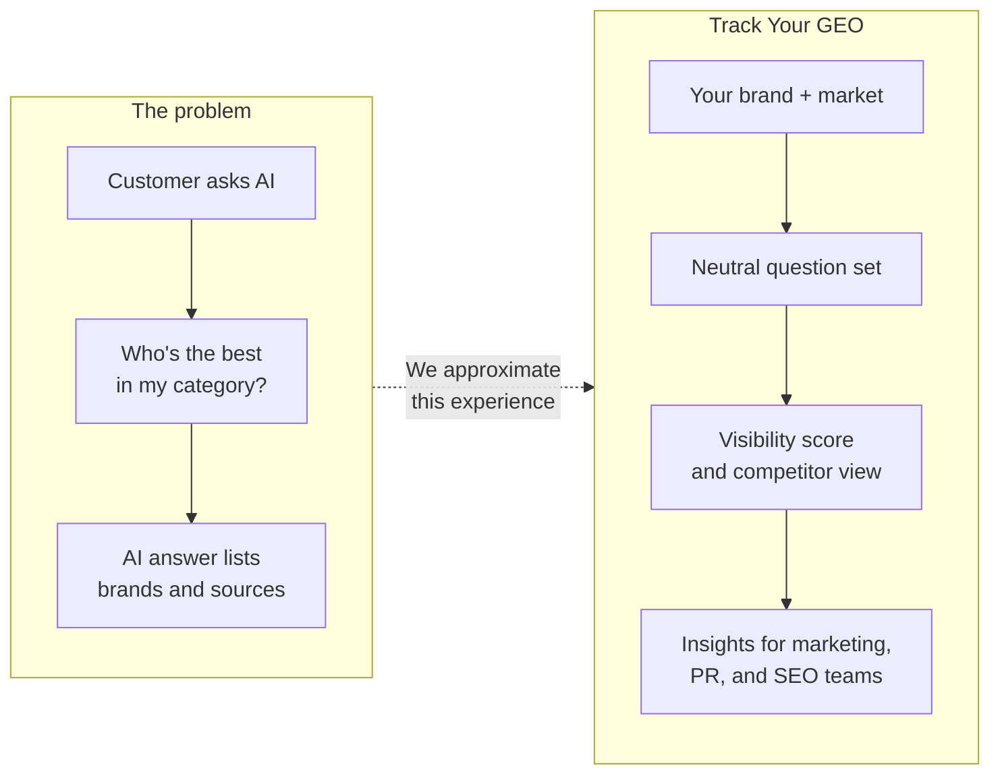
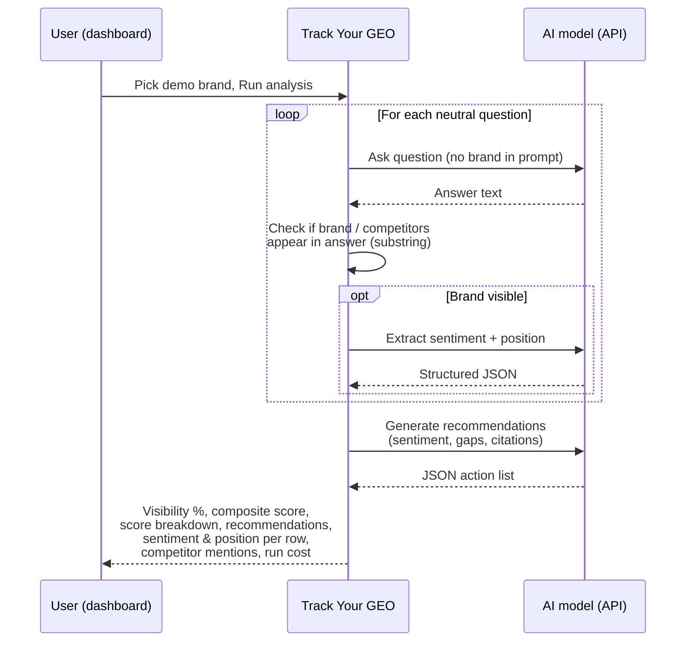

# Track Your GEO — prototype

**Track Your GEO** helps brands see how often they appear when people ask AI assistants industry-style questions (for example, “best Indian restaurant in London”) — and how that compares to named competitors.

This repository holds a **local prototype**: a working demo that runs on a laptop, not a live customer product. It uses built-in demo companies, simulated AI Q&A, and a simple visibility score. Full product vision and personas are in [product_brief.md](product_brief.md).

---

## What this prototype does today

- Pick a **demo brand** (e.g. **Dishoom** in London, **Clio** in the UK) from a web dashboard — if that brand has run before, the **latest results load immediately** (summary, trend chart, insights, and query table).
- Run a batch of **neutral questions** — the brand name is **not** baked into the question text, so answers are not artificially steered toward one name.
- For each answer, check whether your brand (and competitors) **appear in the text**; when the brand is visible, run a **structured extraction** pass for **sentiment** and **mention position**.
- See a **visibility percentage**, a **composite GEO score** (visibility + position + sentiment + citations), a **trend chart** across past runs, a per-question breakdown (with Sentiment and Position columns), competitor mentions, **LLM-generated optimization recommendations**, and approximate **API cost** for the run.

Runs are stored in SQLite (locally under `apps/api/data/`, on Railway on a mounted volume) so you can compare results across sessions without re-running probes.

## How the product is meant to work

Customers increasingly discover brands through **generative AI** (ChatGPT, Claude, Gemini, and similar tools) rather than only through traditional search. Track Your GEO is meant to give marketing, comms, and SEO teams a clear picture of **AI visibility**: where they show up, where they do not, and what to improve — without opaque consultancy-style reporting.



## How an analysis run works

When someone clicks **Run analysis** in the dashboard:

1. The tool loads the demo brand’s question set and competitor list.
2. The API **starts the run immediately** and returns `status: running` (probes continue in the background — a full demo pilot takes **~4–8 minutes** with three models).
3. The UI **polls every few seconds** and shows probe progress (`N complete`).
4. For each **neutral** question, every model in `TYGEO_ENABLED_PROBES` is called (default: OpenAI search, Perplexity sonar-pro, Gemini 2.5 Flash).
5. It records each answer and checks whether the brand name and competitor names appear in the text (substring gate).
6. When the brand is visible, a second **`gpt-4o-mini`** call extracts **sentiment**, **mention position**, and **relevance** (JSON mode).
7. If an individual model fails (e.g. Gemini free-tier quota), other models still run; the summary notes partial results.
8. After all probes finish, a final LLM call generates **3–5 prioritized recommendations** from sentiment patterns, position gaps, citation misses, and competitor wins (~$0.005/run).
9. The dashboard shows visibility %, composite GEO score, **Insights & optimization** (score breakdown + recommendation cards), each question/answer pair (with **model name**, **sentiment**, and **position**), and competitor hits.



## Understanding the score

**Visibility rate** means: *of the neutral questions we asked (across all enabled models), in how many answers does the brand name appear?* (matched as plain text in the reply, case-insensitive).

When the brand is visible, an additional **`gpt-4o-mini`** extraction call records **sentiment** (positive / neutral / negative) and **mention position** (first vs secondary). The **composite GEO score** (0–100) is a weighted blend of visibility, position, sentiment, and citation count per row — see [apps/api/docs/geo-scoring-formula.md](apps/api/docs/geo-scoring-formula.md). The dashboard **Insights & optimization** section visualizes the 40/30/20/10 weighting and lists LLM-generated actions to improve the score.

That is useful for **trends and comparisons** (your brand vs competitors, or this run vs a later run) inside the tool. After each run, **Insights & optimization** turns those signals into prioritized actions (website/SEO, third-party content, PR, technical). It is **not** the same as logging into consumer ChatGPT with web search and checking what one user sees — models, browsing, region, and UI all differ. See [docs/geo-scoring-realism.md](docs/geo-scoring-realism.md) for an honest comparison and how we might improve fidelity over time.

## Product journeys: vision vs this prototype

From [product_brief.md](product_brief.md):

| Journey | What it is | In full product vision | In this prototype |
|--------|------------|------------------------|-------------------|
| **1** | Discover AI visibility | Yes | **Yes** — score, probe list, summary |
| **2** | Diagnose performance gaps | Yes | **Yes** — per-question table, competitor mentions |
| **3** | Tailor dashboard (custom queries, data sources) | Later | **No** |
| **4** | Take action (prioritised recommendations) | Yes | **Yes** — enriched LLM recommendations after each run (sentiment, position, citation gaps, competitors); score breakdown in dashboard §4 |
| **5** | Monitor progress over time | Later | **Partial** — auto-loads last run per brand, visibility trend chart; no alerts or exports |
| **6** | Report internally (export, share) | Later | **No** |

## Try the demo

**Live prototype:** [https://track-your-geo.vercel.app/](https://track-your-geo.vercel.app/)

You need a developer (or someone comfortable with a terminal) to start the app once per machine for **local** use. After that, anyone can use the browser UI:

1. Open the dashboard (usually `http://localhost:5173`, or the [live prototype](https://track-your-geo.vercel.app/)).
2. Choose a **demo brand** from the dropdown — if prior runs exist, the summary and trend chart appear immediately.
3. Optionally click **Run analysis** for a fresh probe batch; review visibility, each Q&A, and competitors.

Built-in demos live as YAML under [`apps/api/pilots/demo/`](apps/api/pilots/demo/) — **Dishoom** (London), **Clio** (UK legal tech), and **SDL Surveying** (UK residential surveys). Add a brand by dropping a `.yaml` file under [`apps/api/pilots/`](apps/api/pilots/) (no code change). Setup steps are under [For developers](#for-developers) below.

Each run uses your configured provider API keys and incurs per-query cost across all enabled probe models, plus a small extraction cost (~$0.001) per **visible** row, plus ~$0.005 for the post-run **recommendations** call. The UI shows approximate spend for the run. A full demo pilot with three models is **30 probe calls** (10 queries × 3 models), plus up to 30 extraction calls when the brand appears in every answer, plus one recommendations call.

## Learn more

| Topic | Document |
|--------|----------|
| Product vision, users, MVP scope | [product_brief.md](product_brief.md) |
| Score vs real ChatGPT-style search | [docs/geo-scoring-realism.md](docs/geo-scoring-realism.md) |
| Composite score formula & recommendations inputs | [apps/api/docs/geo-scoring-formula.md](apps/api/docs/geo-scoring-formula.md) |
| Recent decisions and next steps | [docs/worklog/](docs/worklog/) |

---

## For developers

Local-only stack: **FastAPI** API + **Vite/React** UI. Demo brands load from YAML in [`apps/api/pilots/`](apps/api/pilots/). Human–agent workflow (orient, plan, approve, validate, worklog): [AGENTS.md](AGENTS.md).

### Prerequisites

- **Python 3.11+** (3.12+ recommended)
- **Node.js 20+** for the web UI and OpenSpec CLI (OpenSpec officially wants Node 20.19+)
- An **OpenAI API key** (required). Optional: **Perplexity** and **Gemini** keys for multi-model probes.

### Quick start (Windows)

From the repository root:

1. Create a virtual environment and install the app (example uses `tygeo-venv`):

```powershell
python -m venv tygeo-venv
.\tygeo-venv\Scripts\python.exe -m pip install -U pip setuptools wheel
.\tygeo-venv\Scripts\pip.exe install -e ".[dev,eval]"
```

2. Configure environment:

```powershell
Copy-Item .env.example .env
# Edit .env: set OPENAI_API_KEY; optional PERPLEXITY_API_KEY, GEMINI_API_KEY, TYGEO_ENABLED_PROBES
```

3. Start the API (terminal A), from repo root:

```powershell
.\tygeo-venv\Scripts\uvicorn.exe tygeo.main:app --reload --host 127.0.0.1 --port 8000
```

4. Install and start the web UI (terminal B):

```powershell
cd apps\web
npm install
npm run dev
```

5. Open the URL printed by Vite (usually `http://localhost:5173`), pick a **demo brand** from the dropdown, optionally override brand/location, and click **Run analysis**.

Alternatively run both processes using [scripts/dev.ps1](scripts/dev.ps1).

If the web UI shows proxy errors right after startup, wait a few seconds for the API to finish booting and refresh.

### Repository layout

| Path | Purpose |
|------|---------|
| [apps/api/tygeo/](apps/api/tygeo/) | FastAPI app, LiteLLM calls, SQLite persistence |
| [apps/api/pilots/](apps/api/pilots/) | YAML pilot profiles (demo brands + future customers) |
| [apps/web/](apps/web/) | Vite + React dashboard |
| [openspec/](openspec/) | OpenSpec specs and change proposals |
| [eval/](eval/) | Pytest + DeepEval checks |
| [docs/geo-scoring-realism.md](docs/geo-scoring-realism.md) | Limits of the prototype score vs real assistant search; ways to improve fidelity |
| [apps/api/docs/geo-scoring-formula.md](apps/api/docs/geo-scoring-formula.md) | Weighted composite score (visibility, position, sentiment, citations) and recommendations inputs |
| [docs/worklog/](docs/worklog/) | Session summaries and suggested next steps |
| [product_brief.md](product_brief.md) | Product context |
| [AGENTS.md](AGENTS.md) | Agent/human collaboration workflow |

### OpenSpec

This repo uses [Fission-AI OpenSpec](https://openspec.dev/). Slash commands live under `.cursor/commands/` (for example `/opsx:propose`). After pulling changes, restart Cursor so commands register.

### Evaluation (DeepEval + pytest)

```powershell
.\tygeo-venv\Scripts\pytest.exe eval -q
```

DeepEval is used for a **deterministic substring metric** on golden snippets (no extra LLM calls in that test). Add API-based metrics later as prompts stabilize.

### uv (optional)

If you use [uv](https://github.com/astral-sh/uv): `uv sync` then `uv run pip install -e ".[dev,eval]"` is not needed — use `uv sync --extra dev --extra eval` once `uv` supports extras on your machine.

### Data

SQLite database file defaults to `./data/tygeo.db` (created on first run). Add `data/` to backups if you care about historical runs.

---

## Deployment

Production layout: **Vercel** serves the static React app; the browser calls **Railway** (FastAPI) directly. SQLite lives on a Railway volume so run history survives redeploys.

### Environment variables

| Variable | Where | Value |
|----------|-------|-------|
| `OPENAI_API_KEY` | Railway | Your OpenAI API key |
| `PERPLEXITY_API_KEY` | Railway | Perplexity API key (for `perplexity/sonar-pro`) |
| `GEMINI_API_KEY` | Railway | Google AI Studio key (for `gemini/gemini-2.5-flash`) |
| `TYGEO_ENABLED_PROBES` | Railway | `gpt-5-search-api,perplexity/sonar-pro,gemini/gemini-2.5-flash` |
| `TYGEO_PILOT_DIR` | Railway | `pilots` (relative to `apps/api`; ships with the repo) |
| `TYGEO_ALLOWED_ORIGINS` | Railway | `https://track-your-geo.vercel.app` |
| `TYGEO_DATABASE_URL` | Railway | `sqlite:////data/tygeo.db` |
| `TYGEO_MODEL` | Railway | `gpt-4o-mini` (default) |
| `TYGEO_PROBE_MODEL` | Railway | `gpt-5-search-api` (legacy single-model fallback) |
| `VITE_API_URL` | Vercel | `https://trackyourgeo-production.up.railway.app` |

Locally, leave `VITE_API_URL` unset so the Vite dev proxy handles `/api` requests.

### Multi-model probes and Gemini quota

With all three default models enabled, each demo pilot issues **30 sequential probes**. The UI polls until the run completes — do not close the tab during a run.

**Gemini free tier** (`gemini-2.5-flash` via Google AI Studio) has low per-minute request limits. On production we routinely see **partial runs**: OpenAI and Perplexity succeed; Gemini rows missing with `probe_error` in `usage_log`. Options:

- Enable **paid Gemini billing** when ready for full 3-model coverage.
- Temporarily set `TYGEO_ENABLED_PROBES=gpt-5-search-api,perplexity/sonar-pro` on Railway.

### Railway (backend)

1. [railway.app](https://railway.app) → **New Project** → Deploy from GitHub.
2. Set **Root Directory** to `apps/api`.
3. Add environment variables from the table above. For the first deploy, set `TYGEO_ALLOWED_ORIGINS=*` until you have the Vercel URL.
4. Add a **Volume** mounted at `/data`.
5. Set `TYGEO_DATABASE_URL=sqlite:////data/tygeo.db` (four slashes — absolute path on the volume). **Do not** use `sqlite:///./data/tygeo.db` on Railway; that writes inside the ephemeral container and history is lost on redeploy.
6. Confirm health: `GET https://trackyourgeo-production.up.railway.app/api/health` → `{"status":"ok"}`.

Config: [`apps/api/railway.json`](apps/api/railway.json).

### Vercel (frontend)

1. [vercel.com](https://vercel.com) → **New Project** → Import the GitHub repo.
2. Set **Root Directory** to `apps/web`.
3. Build command: `npm run build`; output directory: `dist`.
4. Set `VITE_API_URL` to your Railway URL (no trailing slash).
5. Deploy and confirm the pilots list loads.

### After both are live

1. Update Railway `TYGEO_ALLOWED_ORIGINS` to your real Vercel URL (replace `*`).
2. Redeploy Railway.
3. Run a full analysis from the Vercel URL and check the browser console for CORS errors.
4. Redeploy Railway once more and confirm prior run history still appears (volume persistence).

---

## AI Recommend Site (airecommend.co.uk)

The `site/` directory contains the AI Recommend marketing website and per-firm report pages. It's a plain static site deployed to Cloudflare Pages.

### Site structure

| Path | Purpose |
|------|---------|
| `site/public/` | Static assets (index.html, privacy.html, robots.txt, sitemap.xml, _headers, _routes.json, styles.css, favicon.svg) |
| `site/templates/` | HTML templates for report pages |
| `site/functions/r/` | Cloudflare Pages Function for D1 logging |
| `site/build.py` | Build script that assembles `site/dist/` |
| `site/config.py` | Configuration with placeholders |

### Configuration

**Already filled in (`site/config.py`):**
- `KIERAN_SURNAME` = "Le Butt"
- `BOOKING_LINK` = Google Calendar 15-min appointment URL
- `TRADING_NAME_LINE` = "AI Recommend is a trading name of Kieran Le Butt"

**Optional placeholders:**
| Placeholder | What to fill in | Default |
|-------------|-----------------|---------|
| `KIERAN_PHONE` | Phone number | empty |
| `CONTACT_ADDRESS` | Business contact address | empty |
| `TRADING_NAME_LINE` | Update when incorporated | has default |

Optionally add photo to `site/public/images/`:
- `kieran.jpg` - Kieran's photo (site renders fine without it)

### Generating a batch of reports

Use `scripts/batch_export.py` to generate PDF reports for a list of firms. The script runs probes via the local API, exports PDFs, and writes a manifest that `site/build.py` can consume directly.

**Prerequisites:**
- Local API running (see [Quick start](#quick-start-windows))
- Input CSV with `firm_name,url` columns

**Input CSV format:**
```csv
firm_name,url,location,display_name
"Example Accountants Ltd","https://example-accountants.co.uk",,
"Rooke & Co Accountants Limited","https://rooke.example","Derby, UK","Rooke & Co"
```

Optional columns:
- `location` — town used in probe questions (overrides website inference). Changing it on a completed firm triggers a **rerun** on the next normal batch.
- `display_name` — trading name shown on the PDF. Brand-mention matching still uses names inferred from the website (so a different firm with a similar name is not counted as you).

**Display vs matching:** `display_name` affects report copy and filenames only. Probes and `brand_mentioned` flags use the inferred `brand_name` and aliases stored on the run.

**Windows PowerShell commands:**

```powershell
# Terminal 1: Start the local API
.\tygeo-venv\Scripts\uvicorn.exe tygeo.main:app --host 127.0.0.1 --port 8000

# Terminal 2: Run the batch (example for wave2)
# First, do a dry run to see what would happen:
.\tygeo-venv\Scripts\python.exe scripts/batch_export.py `
    --batch wave2 `
    --input "G:\My Drive\Obsidian\projects\track-your-geo\reports\wave2-urls.csv" `
    --dry-run

# Then run for real:
.\tygeo-venv\Scripts\python.exe scripts/batch_export.py `
    --batch wave2 `
    --input "G:\My Drive\Obsidian\projects\track-your-geo\reports\wave2-urls.csv"

# After batch completes, build the site:
python site/build.py --vault "G:\My Drive\Obsidian\projects\track-your-geo" --batch wave2

# Deploy to Cloudflare Pages (must run from site/ for functions and wrangler.toml):
cd site
npx wrangler pages deploy dist --project-name airecommend --branch main
cd ..
```

**Output (in vault):**
- `reports/wave2-manifest.csv` — manifest for `site/build.py`
- `reports/wave2-errors.csv` — failed/excluded firms
- `reports/wave2-progress.md` — live progress file
- `reports/wave2-pdfs/` — PDF and markdown files

**Useful options:**
- `--dry-run` — show REGENERATE / RERUN / PROBE / SKIP per firm
- `--regenerate` — re-render PDFs from stored runs (no probe cost); needs API up to read runs
- `--reuse-completed` — skip firms with existing PDFs (default: True)
- `--force` — re-probe every firm even if a PDF exists
- `--limit N` — process only first N firms
- `--offset N` — skip first N firms

**Cost and time:** Approximately **$0.65 per firm** and **15 minutes per firm** (3-model probes with OpenAI search rate limits).

### Building the site

**Default build (public pages + sample report):**
```bash
python site/build.py
```

The sample report uses the fictional `riverside-accountants.example` fixture and
is required for the `/sample-report.pdf` link on the homepage. It's built by
default.

**Skip sample report (not recommended for full deploy):**
```bash
python site/build.py --no-sample
```

**From vault manifest (also generates real report pages):**
```bash
python site/build.py --vault "G:\My Drive\Obsidian\projects\track-your-geo" --batch wave2
```

Output goes to `site/dist/`. The slug-to-firm mapping is written to the vault at `reports/wave2-links.csv` (never committed to git).

### Cloudflare Pages deployment (manual steps for Kieran)

**Prerequisites:**
- Wrangler CLI: `npm install -g wrangler`
- Cloudflare account with the airecommend.co.uk zone

**One-time setup:**

1. Log in to Wrangler:
   ```bash
   wrangler login
   ```

2. Create the D1 database:
   ```bash
   wrangler d1 create airecommend-log
   ```

3. Create the D1 schema:
   ```bash
   wrangler d1 execute airecommend-log --remote --command "CREATE TABLE IF NOT EXISTS hits (id INTEGER PRIMARY KEY AUTOINCREMENT, ts TEXT NOT NULL, slug TEXT NOT NULL, path TEXT NOT NULL, country TEXT, user_agent TEXT, asn INTEGER); CREATE INDEX IF NOT EXISTS idx_hits_slug ON hits(slug); CREATE INDEX IF NOT EXISTS idx_hits_ts ON hits(ts);"
   ```

4. Create `site/wrangler.toml`:
   ```toml
   name = "airecommend"
   compatibility_date = "2024-01-01"

   [[d1_databases]]
   binding = "DB"
   database_name = "airecommend-log"
   database_id = "<your-database-id-from-step-2>"
   ```

**Deploy:**

```bash
# Build from vault (generates report pages)
python site/build.py --vault "G:\My Drive\Obsidian\projects\track-your-geo" --batch wave2

# Deploy to Cloudflare Pages (must run from site/ for functions and wrangler.toml)
cd site
npx wrangler pages deploy dist --project-name airecommend --branch main
cd ..
```

**Add custom domains (Cloudflare dashboard):**

1. Go to Pages → airecommend → Custom domains
2. Add `airecommend.co.uk`
3. Add `www.airecommend.co.uk`
4. Cloudflare creates the DNS records automatically

**Set up www redirect:**

1. Go to Rules → Redirect Rules
2. Create rule: `www.airecommend.co.uk/*` → `https://airecommend.co.uk/$1` (301)

**Enable Web Analytics (optional):**

1. Go to Pages → airecommend → Settings → Web Analytics
2. Enable (free, no cookies)

**DNS warning:** Do NOT touch the existing MX, SPF, DKIM, or DMARC records. They handle email for kieran@airecommend.co.uk.

### Querying report views

```bash
# Count views by slug
wrangler d1 execute airecommend-log --remote --command "SELECT slug, MIN(ts) as first_view, COUNT(*) as views FROM hits GROUP BY slug ORDER BY first_view"

# Recent views
wrangler d1 execute airecommend-log --remote --command "SELECT * FROM hits ORDER BY ts DESC LIMIT 20"
```

### Testing report headers

```bash
curl -I https://airecommend.co.uk/r/sample/ | grep -E "(X-Robots-Tag|Referrer-Policy)"
```

Should show:
```
X-Robots-Tag: noindex, nofollow, noarchive
Referrer-Policy: no-referrer
```
